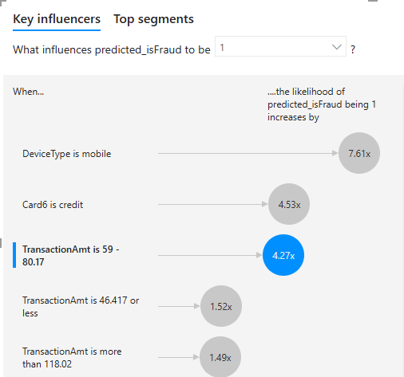

# 📊 End-to-End Financial Fraud Detection BI Platform


A comprehensive Business Intelligence and Data Engineering architecture that processes, analyzes, and detects financial fraud in near-real-time. This project combines the robust **Microsoft BI Stack (SSIS, SSAS, Power BI)** for enterprise-grade analytics with a **Python Machine Learning pipeline** for predictive fraud scoring.

---

## 📌 Project Overview

**The Challenge:** Processing massive volumes of banking transactions (590,000+ records) to not only visualize financial KPIs but to actively detect and block fraudulent activities.

**The Hybrid Solution:**
This project utilizes a dual-engine architecture:
1. **Enterprise Business Intelligence (Microsoft Stack):** 
   - **SSIS (SQL Server Integration Services)**: Highly optimized ETL workflows to extract, clean, and load the raw IEEE-CIS dataset.
   - **SSAS (SQL Server Analysis Services)**: Construction of a Multidimensional Star Schema to aggregate millions of records instantly.
   - **Power BI**: Interactive, dynamic dashboards featuring DAX measures to analyze fraud rates, false positives, and financial impact.
2. **Predictive AI & Real-Time Simulation (Python):** 
   - **Machine Learning**: An `HistGradientBoostingClassifier` trained in Python to assign a fraud probability score to every transaction (92.3% ROC AUC).
   - **Web App**: A FastAPI application that simulates a live transaction feed, allowing an analyst to monitor predictions and take manual actions (Block/Allow).

---

## 🏗️ Architecture & Data Pipelines

### 1. ETL Processes (SSIS)
Data is extracted and transformed into a highly optimized Star Schema format. The workflows handle data cleansing, type casting, and anomaly removal.

| Control Flow | Fact Table ETL |
| :---: | :---: |
|  |  |

*Additional SSIS configurations and dimensions (e.g., `dim_cards`, `dim_devices`, `dim_locations`) are available in the repository screenshots (`Dimensions ETL.png`, `SSIS_clear.png`).*

### 2. Analytical Modeling (SSAS)
A multidimensional cube (Star Schema) was constructed to ensure sub-second query performance in Power BI. 
* **Fact Table**: `fact_transactions` (Includes transaction amounts and ML fraud probability).
* **Dimensions**: Geographies, Devices, Cards, Time.

### 3. Power BI Dashboards & DAX
The final polished reports are contained in `Project1.pbix`. Extensive DAX measures were written to calculate:
* Total Transaction Volumes ($)
* Real Fraud Rate vs. ML Predicted Fraud Rate
* False Positives & Total Fraud Financial Impact

| Power BI KPI Overview | Predictive Score Distribution |
| :---: | :---: |
|  |  |

---

## 🧠 Machine Learning Integration

The Python pipeline (`src/train_model.py`) trains a classification model on the historical data. The predictions are integrated directly back into the data warehouse (`fact_transactions`), allowing Power BI to natively compare actual fraud versus predicted fraud.

**Performance Snapshot:**
* **ROC AUC**: ~92.3%
* **Confusion Matrix**: Visually highlights the model's accuracy in reducing false negatives (allowing fraud through).

<p align="center">
  
</p>

---

## 🚀 Getting Started

### 1. Power BI & SSIS/SSAS
- You can directly open `Project1.pbix` in **Power BI Desktop** to view the final dashboards and DAX measures.
- The SSIS packages and SSAS cubes are located in `ETL_IEEE_Fraud` and `SSAS_IEEE_Fraud` respectively. They can be opened via **Visual Studio (SSDT)**.

### 2. Python Web Simulator (Optional)
To run the live near-real-time API and web dashboard:
1. Ensure Python 3.8+ is installed.
2. Run the automated startup script:
   ```bash
   run_app.bat
   ```
   *(This script auto-installs dependencies, trains the ML model if missing, and boots the FastAPI server).*
3. Open `http://127.0.0.1:8000` to interact with the live transaction feed!

---

## 📄 License

This project is licensed under the [MIT License](LICENSE) - see the LICENSE file for details.
