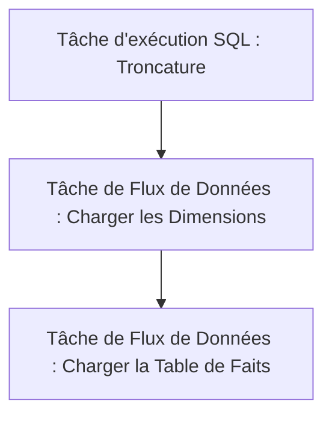

# Guide de Conception ETL avec SSIS (SQL Server Integration Services)

Ce guide détaille étape par étape la conception du package ETL dans **Visual Studio (SQL Server Data Tools - SSDT)** pour alimenter le Data Warehouse `IEEE_Fraud_DW` à partir des fichiers CSV.

---

## 1. Création du Projet dans Visual Studio

1. Ouvrez Visual Studio.
2. Cliquez sur **Créer un projet** et sélectionnez le modèle **Projet Integration Services** (SSIS).
3. Nommez le projet `ETL_IEEE_Fraud` et cliquez sur **Créer**.
4. Dans la boîte à outils SSIS, vérifiez que vous avez accès aux composants de flux de contrôle et de flux de données.

---

## 2. Configuration des Gestionnaires de Connexion (Connection Managers)

Dans le panneau du bas **Gestionnaires de connexions**, faites un clic droit pour ajouter :
1. **Connexion OLE DB (Base de données cible) :**
   * Nom : `SQLServer_IEEE_Fraud_DW`
   * Type : OLE DB Provider for SQL Server.
   * Serveur : `.` ou `localhost` (ou le nom de votre instance SQL Server).
   * Base de données : `IEEE_Fraud_DW`.
2. **Connexion Fichier Plat (Source Transactions) :**
   * Nom : `CSV_Transactions`
   * Fichier : Sélectionner `train_transaction.csv`.
   * Délimiteur de colonnes : Virgule `,`.
   * Cochez la case **"Noms de colonnes dans la première ligne de données"**.
   * Dans l'onglet **Avancé**, configurez les types des colonnes les plus importantes (ex: `TransactionID` en entier 4 octets, `TransactionAmt` en float/double, etc.).
3. **Connexion Fichier Plat (Source Identités) :**
   * Nom : `CSV_Identities`
   * Fichier : Sélectionner `train_identity.csv`.
   * Configuration similaire (délimiteur virgule, première ligne contient les en-têtes).

---

## 3. Conception du Flux de Contrôle (Control Flow)

Faites glisser les composants suivants sur l'onglet **Flux de contrôle** :



### Étape A : Tâche d'exécution SQL (Execute SQL Task)
* **Nom :** `TRUNCATE Tables`
* **Connection :** `SQLServer_IEEE_Fraud_DW`
* **SQLStatement :**
  ```sql
  -- Vider la table de faits d'abord à cause des clés étrangères
  TRUNCATE TABLE Fact_Transactions;
  -- Vider les dimensions
  TRUNCATE TABLE Dim_Cards;
  TRUNCATE TABLE Dim_Devices;
  TRUNCATE TABLE Dim_Locations;
  ```

---

## 4. Conception du Flux de Données 1 : Chargement des Dimensions (dim_load)

Créez une **Tâche de flux de données** nommée `Charger les Dimensions`. Double-cliquez dessus pour ouvrir l'espace de conception du flux de données.

### Étape 1 : Chargement des Sources et Jointure
1. **Source Fichier Plat 1 :** Connectez à `CSV_Transactions` (Colonnes requises : `TransactionID`, `card1`, `card2`, `card3`, `card4`, `card5`, `card6`, `addr1`, `addr2`).
2. **Source Fichier Plat 2 :** Connectez à `CSV_Identities` (Colonnes requises : `TransactionID`, `DeviceType`, `DeviceInfo`, `id_30` [OS], `id_31` [Browser]).
3. **Transformation de Tri (Sort) :**
   * Glissez deux composants **Sort** (Tri).
   * Triez la source Transactions sur la clé `TransactionID` (ordre croissant).
   * Triez la source Identités sur la clé `TransactionID` (ordre croissant).
4. **Jointure de Fusion (Merge Join) :**
   * Reliez les deux flux triés au composant **Merge Join**.
   * Type de jointure : **Left Outer Join** (pour conserver toutes les transactions, même si l'appareil est inconnu).
   * Clé de jointure : `TransactionID`.

### Étape 2 : Nettoyage des Données (Colonne Dérivée)
Glissez un composant **Derived Column** (Colonne Dérivée) pour remplacer les valeurs NULLs par des valeurs par défaut pour les dimensions :
* **Derived Column Name :** `clean_card4` | **Expression :** `REPLACENULL(card4, "missing")`
* **Derived Column Name :** `clean_card6` | **Expression :** `REPLACENULL(card6, "missing")`
* **Derived Column Name :** `clean_DeviceType` | **Expression :** `REPLACENULL(DeviceType, "missing")`
* **Derived Column Name :** `clean_DeviceInfo` | **Expression :** `REPLACENULL(DeviceInfo, "missing")`
* **Derived Column Name :** `clean_OS` | **Expression :** `REPLACENULL(id_30, "missing")`
* **Derived Column Name :** `clean_Browser` | **Expression :** `REPLACENULL(id_31, "missing")`

### Étape 3 : Dédoublonnement et Insertion dans les Dimensions
Puisque les tables de dimensions ne doivent contenir que des lignes uniques :
1. **Dimension Cartes (Dim_Cards) :**
   * Glissez un composant **Sort** branché après la colonne dérivée.
   * Cochez uniquement les colonnes de carte (`card1`, `card2`, `card3`, `clean_card4`, `card5`, `clean_card6`).
   * **Important :** Cochez la case tout en bas : **"Remove rows with duplicate sort values"** (Supprimer les lignes avec des valeurs de tri en double).
   * Connectez à une destination **OLE DB Destination** pointant vers la table `Dim_Cards`. Mappez les colonnes correspondantes.
2. **Dimension Appareils (Dim_Devices) :**
   * Utilisez un flux parallèle ou un composant **Multicast** pour dupliquer les données propres.
   * Glissez un composant **Sort**, cochez (`clean_DeviceType`, `clean_DeviceInfo`, `clean_OS`, `clean_Browser`) et cochez **"Remove rows with duplicate sort values"**.
   * Connectez à une destination **OLE DB Destination** pointant vers `Dim_Devices`.
3. **Dimension Localisations (Dim_Locations) :**
   * De même, glissez un composant **Sort**, cochez (`addr1`, `addr2`), cochez **"Remove rows with duplicate sort values"**.
   * Connectez à une destination **OLE DB Destination** pointant vers `Dim_Locations`.

---

## 5. Conception du Flux de Données 2 : Chargement de la Table de Faits (fact_load)

Retournez dans le flux de contrôle. Reliez la tâche précédente à la nouvelle tâche de flux de données nommée `Charger la Table de Faits`. Double-cliquez dessus.

### Étape 1 : Fusionner et Nettoyer la Source Transactions
1. Répétez la même jointure de fusion (**Merge Join** triée) entre `CSV_Transactions` et `CSV_Identities` pour récupérer toutes les colonnes de transaction et d'appareil.
2. Utilisez un composant **Derived Column** pour appliquer le même nettoyage des valeurs manquantes (`REPLACENULL`) sur les chaînes de caractères.

### Étape 2 : Récupération des Clés Étrangères (Lookup / Recherche)
Puisque la table de faits stocke uniquement des clés de substitution numériques (`CardKey`, `DeviceKey`, `LocationKey`), nous devons effectuer des recherches dans les dimensions chargées à l'étape précédente.

1. **Recherche Cartes (Lookup Cards) :**
   * Glissez un composant **Lookup**. Connectez le flux propre à l'entrée de recherche.
   * **Connexion :** Sélectionnez la table `Dim_Cards`.
   * **Colonnes (Mappage) :** Reliez les colonnes d'entrée (`card1`, `card2`, `card3`, `clean_card4`, `card5`, `clean_card6`) aux colonnes de la table `Dim_Cards`.
   * **Sortie :** Cochez la colonne `CardKey` pour l'ajouter au flux de données.
2. **Recherche Appareils (Lookup Devices) :**
   * Glissez un second composant **Lookup** branché à la suite du premier.
   * **Connexion :** Sélectionnez la table `Dim_Devices`.
   * **Colonnes :** Reliez (`clean_DeviceType`, `clean_DeviceInfo`, `clean_OS`, `clean_Browser`) aux colonnes de `Dim_Devices`.
   * **Sortie :** Cochez la colonne `DeviceKey` pour l'ajouter au flux de données.
3. **Recherche Localisations (Lookup Locations) :**
   * Glissez un troisième composant **Lookup** branché à la suite.
   * **Connexion :** Sélectionnez la table `Dim_Locations`.
   * **Colonnes :** Reliez (`addr1`, `addr2`) aux colonnes de `Dim_Locations`.
   * **Sortie :** Cochez la colonne `LocationKey`.

### Étape 3 : Chargement final
Reliez la sortie du dernier composant Lookup à une **OLE DB Destination** pointant vers `Fact_Transactions` :
* Mappez les clés récupérées : `CardKey`, `DeviceKey`, `LocationKey`.
* Mappez les attributs : `TransactionID`, `TransactionDT`, `TransactionAmt`, `ProductCD`, `P_emaildomain`, `R_emaildomain`, `C1`, `C2`, `C11`, `C13`, `C14`, `D1`, `D2`, `D10`, `D15`, `isFraud`.
* Exécutez le projet !
